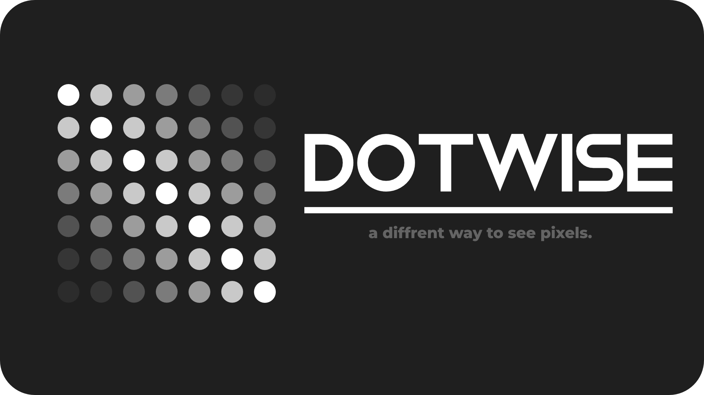
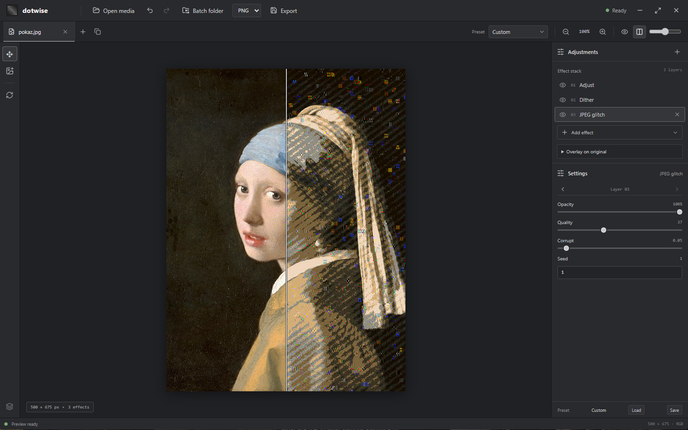

# Dotwise



A Rust-powered image dithering and effects editor with a React + Tauri desktop interface, command-line tools, batch processing, and video support.

## Showcase



## Features

- Error-diffusion, Bayer, halftone, line, white-noise, gradient-noise, and blue-noise dithering
- Built-in, grayscale, duotone, CGA, Game Boy, custom, and image-extracted palettes
- A stackable pipeline with adjustments, blur, scaling, glow, scanlines, grain, glitches, posterization, gradient maps, and sharpening
- Live preview, zoom and pan, original/result comparison, layer controls, and undo/redo
- Built-in presets and reusable JSON pipelines
- PNG, JPEG, and SVG image export
- Batch processing of PNG and JPEG folders
- Video preview and export, including animated noise and temporal hold

## Requirements

- A current stable Rust toolchain and Cargo
- Node.js 20 or newer and npm for the React/Tauri desktop app
- `ffmpeg` and `ffprobe` on `PATH` for video import and export
- On Windows, the Microsoft Edge WebView2 Runtime. The Inno Setup installer in `instalator/` includes Microsoft's signed bootstrapper and runs it only if the runtime is missing.
- On Linux, the system WebKitGTK 4.1 development/runtime packages and the usual Tauri build dependencies. For Debian/Ubuntu:

  ```sh
  sudo apt install build-essential curl wget file libxdo-dev libssl-dev librsvg2-dev patchelf libwebkit2gtk-4.1-dev
  ```

The Linux WebView uses WebKitGTK; it does not require Microsoft Edge. Package names vary by distribution.

## Desktop app

Install JavaScript dependencies and start the development app:

```sh
npm ci
npm run tauri dev
```

Create a self-contained release build with the frontend embedded in the app:

```sh
npm run tauri build
```

On Windows, build the NSIS installer with:

```powershell
npm run tauri build -- --bundles nsis
```

The release executable is written to `target/release/`. Tauri bundles are written below `target/release/bundle/`.

To create the additional Inno Setup installer, first build the release executable, then compile `instalator/Dotwise.iss` with Inno Setup 6. The script writes `instalator/Dotwise-Setup-0.1.0-x64.exe` and expects `instalator/WebView2Bootstrapper.exe` alongside it.

## Command line

Build the CLI:

```sh
cargo build --release -p dotwise_cli
```

Process an image with a built-in preset. The output extension selects PNG, JPEG, or SVG:

```sh
cargo run --release -p dotwise_cli -- input.png output.png --preset "Classic mono"
cargo run --release -p dotwise_cli -- input.png output.svg --preset "Newsprint"
```

Dump a preset to JSON, edit it, and use it as a pipeline:

```sh
cargo run --release -p dotwise_cli -- --dump "Duotone" > duotone.json
cargo run --release -p dotwise_cli -- input.png output.png --pipeline duotone.json
```

Batch process a folder:

```sh
cargo run --release -p dotwise_cli -- batch ./input ./output --preset "Handheld green"
```

Process a video (requires `ffmpeg` and `ffprobe`):

```sh
cargo run --release -p dotwise_cli -- video input.mp4 output.mp4 --preset "Blue noise"
```

For all CLI options:

```sh
cargo run --release -p dotwise_cli -- --help
```

## Development

Run the Rust workspace tests and build the frontend:

```sh
cargo test --workspace
npm run build
```

The workspace is split into `dotwise_core` (image pipeline), `dotwise_video` (video and batch processing), `dotwise_cli` (command line), and `dotwise_gui` (Tauri desktop app and React UI).

## License

Dotwise is licensed under the MIT License. See [LICENSE](LICENSE).
